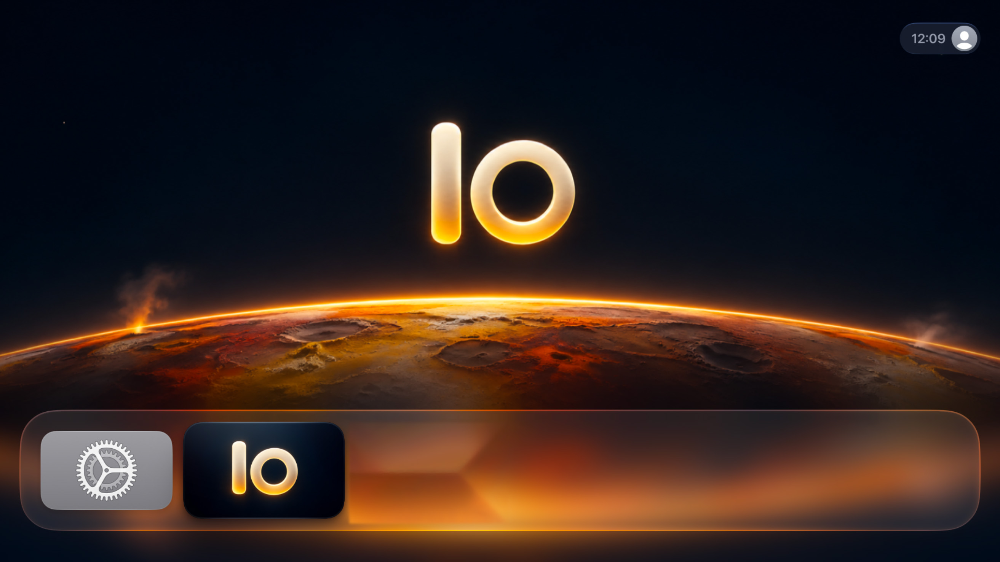

# Io

Io is an independent Apple TV app for watching ERR Jupiter.

- **Otse** plays live ETV, ETV2 and ETV+. Its **Lemmikud** shelf appears once you mark a programme as a favourite.
- **Telekava** shows the schedule for all three channels, highlights what’s on now and opens live or on-demand playback where available.
- **Saated** browses the Jupiter catalogue
- **Lasteekraan** browses ERR’s children’s catalogue
- **Jätka** lets you resume unfinished programmes from your saved position. Viewing history and favourites are stored on the Apple TV.
- **Otsi** searches Jupiter for programmes.

## Install on your Apple TV

You’ll need a Mac with Xcode and a compatible tvOS SDK, an Apple TV running tvOS 27.0 or later, and your own Apple Account. Playback requires an internet connection.

1. Clone the repository or download and extract it using **Code → Download ZIP** on GitHub. Open `Io.xcodeproj` in Xcode.
2. In **Xcode → Settings → Apple Accounts**, add your Apple Account. Select the **Io** target and open **Signing & Capabilities**. Enable **Automatically manage signing**, choose your own **Team** (your **Personal Team** works), and replace `ee.personal.jupiterclient` with a unique bundle identifier, such as `com.yourname.io`.
3. Connect the Mac and Apple TV to the same local network. On Apple TV, open **Settings → Remotes and Devices → Remote App and Devices**. In Xcode, open **Device Hub**, select your Apple TV and enter the pairing code shown on the TV. If Xcode prompts you to enable Developer Mode, follow the prompts. [Apple’s Device Hub guide](https://developer.apple.com/documentation/xcode/managing-your-simulated-and-physical-devices-in-device-hub)
4. In Xcode, select the **Io** scheme and your Apple TV as the run destination, then press **⌘R**. Xcode builds, signs, installs and opens Io.

To update Io or renew an expired development installation, run it again from Xcode with the same Team and bundle identifier. Keep the existing installation in place to retain local viewing history and favourites. Personal Team provisioning profiles expire seven days after issuance. [Apple’s Personal Team documentation](https://developer.apple.com/help/account/basics/about-your-developer-account)

## ERR content and trademarks

Io is an independently developed Apple TV app. It is not affiliated with
or endorsed by Eesti Rahvusringhääling (ERR).

Live streams are played directly from sources provided by ERR. Io does not
host or permanently store the live video. Rights in programmes, artwork,
logos, and trademarks remain with their respective owners. Publication of
Io’s source code does not grant any rights to ERR content or services.

[ERR terms of use](https://info.err.ee/982667/kasutustingimused-ja-kommenteerimine)
